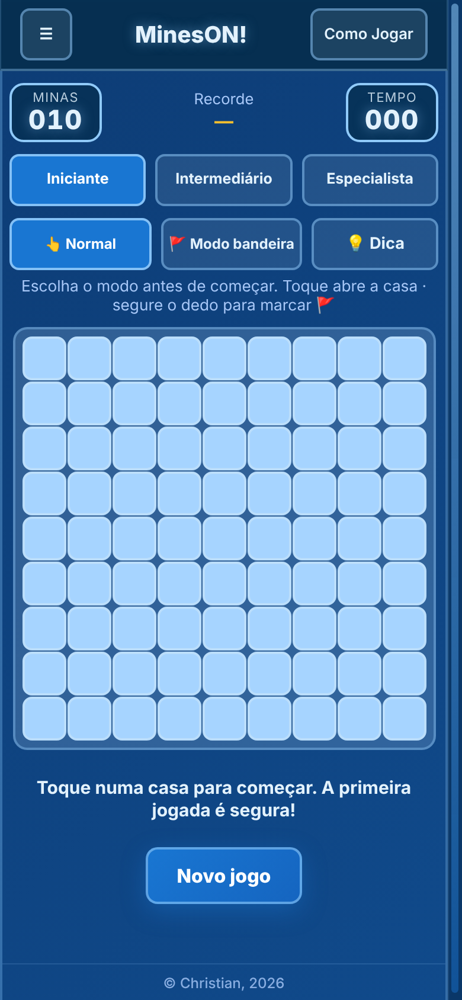
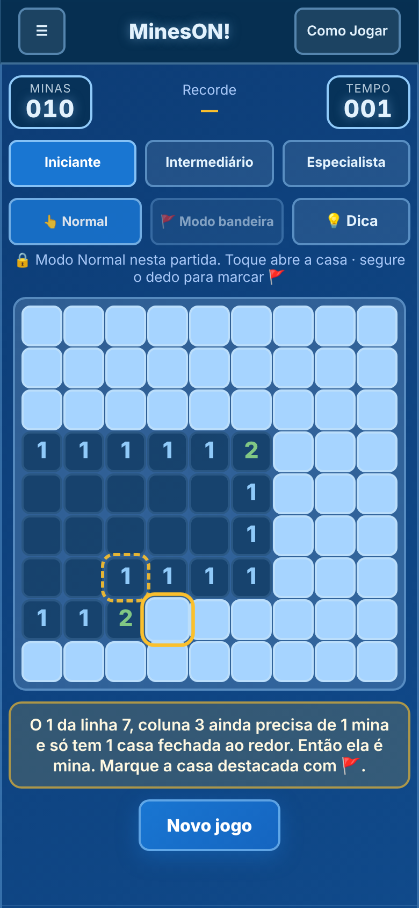
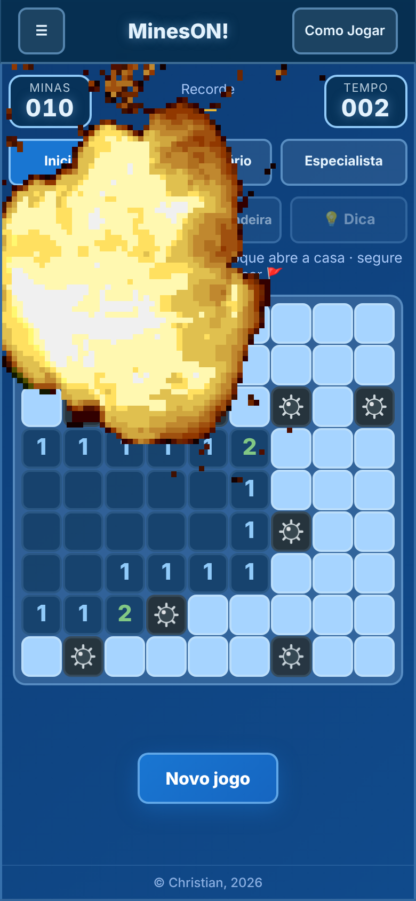
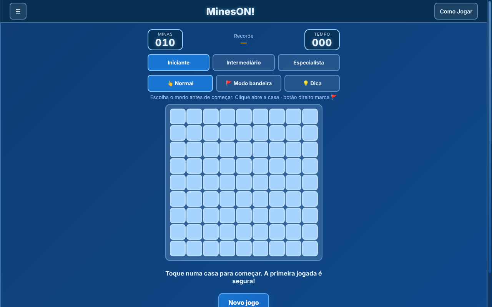

# MinesON!

Campo minado com o visual da família ON!, feito para celular e computador e pensado para **quem nunca jogou**: tutorial completo, botão de dica que explica o raciocínio, três níveis, bandeiras, "abrir em volta", explosão com som e animação, estatísticas e jogo offline.

**Jogue:** https://mineson.netlify.app/ · **Mais jogos:** https://speccygames.netlify.app/

<p align="center">
  
  &nbsp;&nbsp;
  
  &nbsp;&nbsp;
  
</p>
<p align="center">
  
</p>

## Como jogar

Abra todas as casas que **não** têm mina. Cada número mostra quantas minas existem nas 8 casas ao redor. A primeira jogada é sempre segura (ela e as casas vizinhas nunca têm mina). O botão **Como Jogar** explica tudo, com exemplos desenhados.

| Ação | Mouse | Toque | Teclado |
|---|---|---|---|
| Abrir casa | clique esquerdo | toque | `Enter` / `Espaço` |
| Marcar mina 🚩 | clique direito | segurar o dedo | `F` |
| Abrir em volta | clique no número | toque no número | `Enter` no número |
| Novo jogo | botão **Novo jogo** | idem | `R` |
| Mover o foco | | | setas |

"Abrir em volta" funciona num número que já tem a quantidade certa de bandeiras ao redor. Se alguma bandeira estiver errada, é explosão.

### Modo bandeira

Inverte os controles: o toque simples marca a bandeira e segurar abre a casa (bom em telas pequenas). O modo é escolhido **antes da primeira jogada** e fica travado 🔒 durante a partida; para trocar, comece um novo jogo.

### Dica 💡

Procura uma jogada que dá para ter **certeza** usando só o que está visível na tela, destaca a casa e explica o porquê. Partida com dica não conta como recorde.

### Níveis

| Nível | Tabuleiro | Minas |
|---|---|---|
| Iniciante | 9 × 9 | 10 |
| Intermediário | 16 × 16 | 40 |
| Especialista | 30 × 16 (16 × 30 em telas estreitas) | 99 |

## Recursos

- Contador de minas, cronômetro e melhor tempo por nível
- **Explosão** ao perder: `explosion.mp3` em volume máximo, `explosion.gif` tocando **uma única vez** e vibração forte no celular e tremor do tabuleiro (cada um com a sua opção; veja Configurações)
- Menu lateral: atalho **Outros Jogos** (leva à hub), **estatísticas** (jogos, vitórias, sequência, melhores tempos), **configurações** (som, vibração, tremor, modo escuro, reduzir animações), instalar app e redes
- Partida em andamento salva automaticamente: feche a aba e continue depois
- Cronômetro pausa quando a aba fica em segundo plano
- Tabuleiro grande, que se ajusta à tela; respeita `prefers-reduced-motion`
- **PWA:** instala e funciona offline
- Sem dependências, sem build

## Estrutura

```
.
├── index.html
├── on.css / on.js        base compartilhada ON! (igual em todos os projetos)
├── colorido.css          estilos só do MinesON!
├── javinhas.js           lógica, entrada, dica e efeitos
├── manifest.json         dados do PWA
├── service-worker.js     cache para uso offline
├── screenshots/
└── assets/
    ├── icon-192.png, icon-512.png, icon-maskable-512.png, apple-touch-icon.png, favicon.ico
    ├── explosion.mp3, explosion.gif
    └── qrpix.png
```

## Dados salvos no navegador

| Chave (`localStorage`) | Conteúdo |
|---|---|
| `minesON.jogo` | partida em andamento (inclui o modo escolhido) |
| `minesON.nivel` / `minesON.modo` | último nível e último modo |
| `minesON.stats` | sequência e, por nível, jogos, vitórias e melhor tempo |
| `minesON.visto` | tutorial já exibido na primeira visita |
| `mineson.cfg` | som, vibração, tremor, modo escuro, reduzir animações |

## Sobre os arquivos de explosão

`explosion.gif` (17 quadros de 100 ms) foi ajustado para **não repetir**: o jogo cria uma imagem nova a cada explosão e a remove ao terminar. `explosion.mp3` foi normalizado para o volume máximo sem estourar. Se trocar os arquivos, ajuste `EXPLOSAO_GIF` em `javinhas.js` (tamanho, centro e duração).

## Rodando localmente

O service worker precisa de `http://`, então use um servidor local em vez de abrir o arquivo direto:

```bash
python3 -m http.server 8000
# abra http://localhost:8000
```

## Publicando (Netlify)

O jogo é estático: não há build. No Netlify, arraste a pasta do projeto (ou ligue o repositório) com **publish directory** na raiz e **build command** vazio. Todos os caminhos são relativos.

- Endereço: **https://mineson.netlify.app/**
- O menu lateral tem um atalho "Outros Jogos" que abre a hub (`https://speccygames.netlify.app/`). **Adicionar um jogo novo não exige publicar este jogo de novo**: a lista fica só na hub.

## Instalando como app

- **Chrome / Edge (computador e Android):** botão **Instalar app** no menu ☰ (aparece quando o navegador permite) ou o ícone na barra de endereço.
- **Safari (iPhone/iPad):** compartilhar → *Adicionar à Tela de Início*.

## Atualizando o jogo

O service worker entrega os arquivos do cache primeiro. A cada publicação com arquivo alterado, aumente a versão em `CACHE_NAME` no `service-worker.js` (`minesON-v4` → próxima), senão quem já abriu o jogo continua vendo a versão antiga. Se criar ou remover arquivos, atualize também a lista `FILES_TO_CACHE` (ou rode `gerar-sw.py`, descrito em `PADRAO.md`).

## Base compartilhada ON!

`on.css` e `on.js` são **idênticos em todos os projetos** (header, menu lateral, modais, botões, rodapé, configurações, estatísticas, som e vibração). O que é específico do jogo fica em `colorido.css` e `javinhas.js`. Detalhes e regras em `PADRAO.md`.

## Família ON!

MinesON! segue a base visual do **DiciON!**, junto com o **2048ON!**. É inspirado no clássico Campo Minado do Windows.

---

Feito por Christian ([@Christian5910](https://github.com/Christian5910)).
